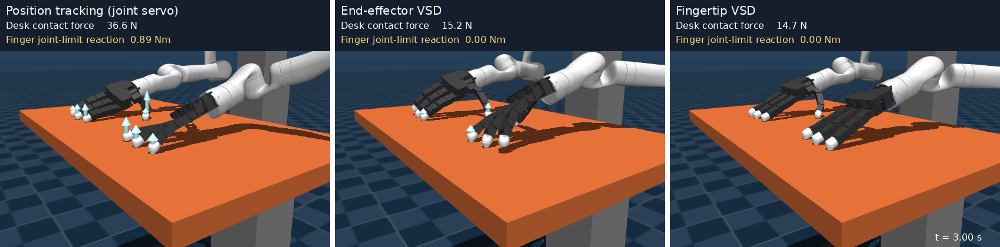
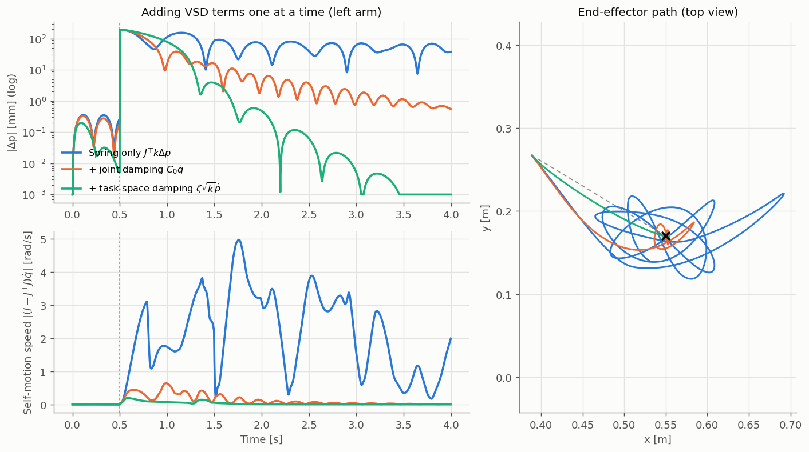
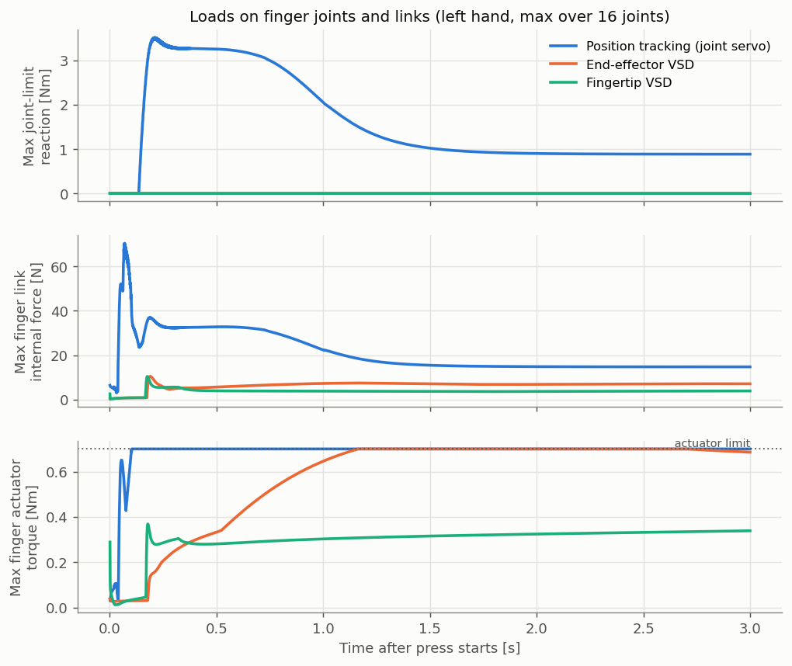

# Virtual Spring–Damper (VSD) Torque Control of a Dual-Arm Kinova Gen3

**Fingertip-level compliance control using the multibody Jacobian** — implementation for the Advanced Robot Manipulation course project

VSD control is implemented at the joint-torque level on a MuJoCo model of two Kinova Gen3 (7-DoF) arms with Allegro hands.
Using the multibody Jacobian obtained from the Lie Group product of exponentials (PoE), **a VSD is attached to every fingertip**, and we test whether the whole hand then complies well with contact.

| Position tracking (joint servo) · end-effector VSD · fingertip VSD — pressing toward a target below the desk for 3 s |
|:--:|
|  |

---

## 1. Background and hypothesis

In contact-rich tasks, **compliance** — keeping contact forces bounded when the hand touches something — matters as much as positioning accuracy.
VSD control (Arimoto & Sekimoto) applies joint torques as if virtual springs and dampers connected the end-effector to its target, producing reaching motion and compliance from `Jᵀ` and `g(q)` alone, without inverse kinematics.

When the VSD acts only on the arm end-effector (wrist), however, the fingers are left outside the controller, and the force produced by the arm concentrates on whichever finger touches first.
The arm and hand form a tree that branches at the palm into four fingers, so the Jacobian of each fingertip can be computed with PoE.

> **Hypothesis.** If a virtual spring–damper is attached to each fingertip and its force is mapped to arm and finger joint torques through the PoE fingertip Jacobian, compliance is defined directly at the contact points and the whole hand complies well with contact.

## 2. System

- MuJoCo 3.5, `Δt = 1 ms` (1 kHz control), two Gen3 7-DoF arms + two Allegro hands (16 joints each), 46 DoF in total
- Every actuator is a torque input, configured from the Kinova Gen3 specifications

| Item | Large (joints 1–4) | Small (joints 5–7) |
|---|---|---|
| Gear ratio | 100:1 | 100:1 |
| Torque limit | 39 Nm | 9 Nm |
| Velocity limit | 1.39 rad/s | 1.22 rad/s |
| Coulomb / viscous friction | 2.15 Nm / 2.00 Nm·s/rad | 1.60 Nm / 1.36 Nm·s/rad |
| Reflected rotor inertia (assumed) | 0.015 kg·m² | 0.0193 kg·m² |

The forward kinematics and Jacobian computed independently from homogeneous transforms match MuJoCo to within `2.4e-15`.

## 3. Torque control architecture (two layers)

**Upper layer — VSD joint-torque control** ([`vsd_controller.py`](src/scripts/vsd_controller.py))

```
τ_d = −C₀ q̇ − Jᵀ{ f_s(Δp) + ζ√k ṗ } + J_ωᵀ{ m_s(e_o) − ζ_o√k_o ω } + g(q) + Jᵀ f_rep
C₀ = α √H₀,  H₀ = diag(Σⱼ H_M,ij)        (joint damping from an inertia bound)
f_s : spring saturated at |kΔp| ≤ f_max    (keeps joint velocities within limits)
f_rep = k_rep (x_r − x_l)/‖x_r − x_l‖²     (dual-arm repulsive potential)
```

**Lower layer — emulated Kinova low-level torque mode** ([`kinova_actuator.py`](src/scripts/kinova_actuator.py))

```
τ_m = τ_d + I,   I ← λI + K_i Δt (τ_d − τ_s)      (leaky-integrator loop on the joint torque sensor)
MuJoCo input = τ_m / N   (N = 100)
```

## 4. Fingertip VSD with the PoE multibody Jacobian

([`lie_jacobian.py`](src/scripts/lie_jacobian.py), [`contact_experiment.py`](src/scripts/contact_experiment.py))

Notation follows the reference: twist `V = (vᵀ, ωᵀ)ᵀ`, `⌈·⌉` maps to `so(3)`/`se(3)`, and `Ad_T = [[R, ⌈r⌉R], [0, R]]`.

```
exp(λ) = [[exp(ξ), dexp_ξ η], [0, 1]],   λ = (ηᵀ, ξᵀ)ᵀ
exp(ξ) = I + α⌈ξ⌉ + (β/2)⌈ξ⌉²,  dexp_ξ = I + (β/2)⌈ξ⌉ + (1−α)/‖ξ‖² ⌈ξ⌉²
α = sin‖ξ‖/‖ξ‖,  β = 2(1−cos‖ξ‖)/‖ξ‖²

S_k   = (v_kᵀ, ω_kᵀ)ᵀ,  v_k = −ω_k × r_k               (screw axis at q = 0)
J_s,k = Ad_{exp(S₁q₁)⋯exp(S_{k−1}q_{k−1})} S_k           (path to fingertip i: 7 arm + 4 finger joints)
J_i   = J_s,v − ⌈p_i⌉ J_s,ω  ∈ ℝ^{3×11}
τ     = −C₀ q̇ − Σᵢ J_iᵀ { f_s⁽ⁱ⁾(Δp_i) + c_i ṗ_i } + g(q)   (7 arm + 16 finger = 23 joints)
```

Each fingertip uses 1/4 of the end-effector VSD stiffness, damping, and force limit, so the total virtual stiffness is the same. The PoE Jacobian matches MuJoCo to within `8.7e-15`.

## 5. Results

**Reaching** (step of about 191 mm and 28.6°, left arm)

| Settling time | Overshoot | Steady-state error | Peak joint velocity / limit | Peak joint torque / limit |
|---|---|---|---|---|
| 1.16 s | 2.4 % | 0.00 mm | 52 % | 51 % |

**Contact** (target placed below the desk surface and pressed for 3 s, left hand, steady state = mean over the last 0.5 s)

| Method | Contact force peak / steady [N] | Per-finger steady [N] (index/middle/ring/thumb) | Finger link internal force [N] | Peak finger torque | Peak arm torque |
|---|---|---|---|---|---|
| Position tracking (joint servo) | 133.0 / 36.6 | 8.9 / 6.9 / 5.9 / 15.0 | 14.8 | 100% | 100% |
| End-effector VSD | 16.3 / 15.3 | 5.5 / 2.6 / 0.0 / 7.2 | 7.2 | 100% | 36% |
| Fingertip VSD | 27.7 / 14.7 | 3.5 / 3.6 / 3.6 / 4.0 | 3.9 | 53% | 34% |

- The VSD contact force is about 2.4× smaller than position tracking at steady state and about 8.2× smaller at the first impact.
- With the end-effector VSD, the force concentrates on the fingers that touch first and their torques saturate. The fingertip VSD shares the same total force evenly among the four fingers and reduces the steady-state finger link force by 46%.

| Adding VSD terms one at a time | Loads on finger joints and links |
|:--:|:--:|
|  |  |

Videos: [reaching](src/output/reach/vsd_reach.mp4) · [dual-arm repulsion](src/output/repulsion/vsd_repulsion.mp4) · [contact comparison](src/output/contact/contact_compare.mp4)

## 6. Repository layout

```
src/
├── xml/                       dual-arm Gen3 + Allegro MuJoCo model (torque inputs, home keyframe), meshes/
├── scripts/
│   ├── common.py              shared paths and model helpers
│   ├── compute_home_pose.py   inverse kinematics for the home pose
│   ├── vsd_controller.py      VSD controller (upper layer)
│   ├── kinova_actuator.py     Kinova low-level torque mode emulation (lower layer)
│   ├── lie_jacobian.py        PoE multibody Jacobian
│   ├── stage_experiments.py   kinematics/gravity checks, compensation and VSD stage experiments
│   ├── run_vsd.py             reaching and dual-arm repulsion scenarios, videos and logs
│   ├── contact_experiment.py  desk contact experiment (position tracking / end-effector VSD / fingertip VSD)
│   ├── analyze_vsd.py         time responses, phase portraits, performance metrics
│   ├── compare_runs.py        comparison (ablation) figures
│   └── make_report.py         runs all experiments and analyses
└── output/                    result figures, videos, and metrics
```

## 7. Usage

```bash
pip install -r requirements.txt          # video rendering also requires ffmpeg
cd src/scripts
python3 run_vsd.py --scenario reach --viewer     # watch VSD reaching in the MuJoCo viewer
python3 make_report.py --rerun --no-pdf          # rerun every experiment and analysis (about 2 min)
python3 contact_experiment.py                    # contact experiment only
```

## 8. Limitations and future work

1. **Validation on real hardware.** The Allegro Hand (V4) has no joint torque sensors and supports only current-based feedforward torque control, and the Kinova Gen3, although it has joint torque sensors, does not disclose its low-level torque loop, so accurate torque control cannot be expected on either device. The method should be validated on a manipulator with a torque-feedback low-level structure, such as the Franka Emika Panda, together with a hand driven by motors whose current can be read and commanded as torque at the low level.
2. **Intuitive commands for fingertip targets.** Each hand needs four target points, so they must come from teleoperation that tracks a human hand (e.g., with a VR device). Commanding the wrist with a single pose on `SE(3)` is intuitive, but intuitive representations of fingertip targets are still lacking; there is likely a better representation space than simply listing points on a Lie Group manifold.

## Reference

- J. Kim, M. Sung, Y. Choi, J. Park, and W. K. Chung, "Impedance control design framework using commutative map between SE(3) and se(3)," *IEEE Transactions on Robotics*, vol. 41, pp. 6193–6212, 2025. doi: [10.1109/TRO.2025.3619066](https://doi.org/10.1109/TRO.2025.3619066)

The model meshes come from Kinova `ros_kortex` and the Allegro hand model in MuJoCo Menagerie, and remain under their original licenses.
