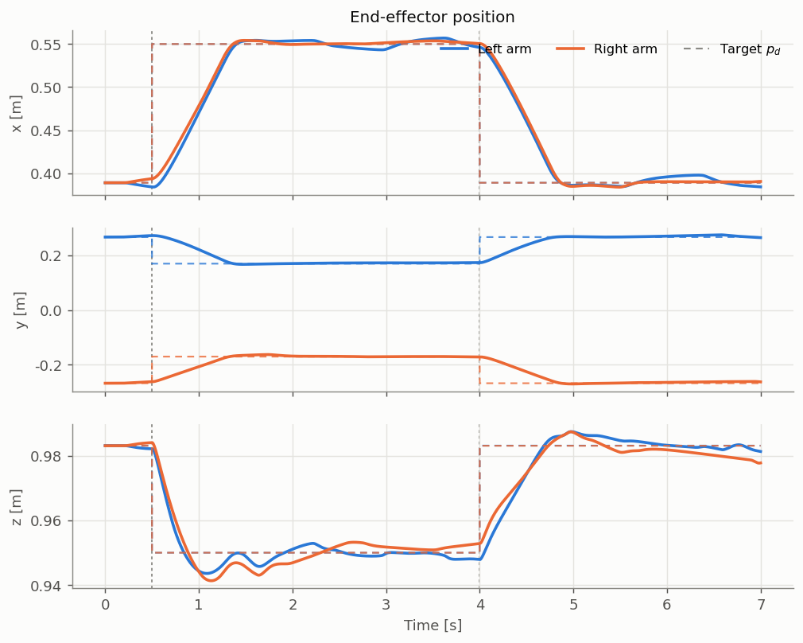
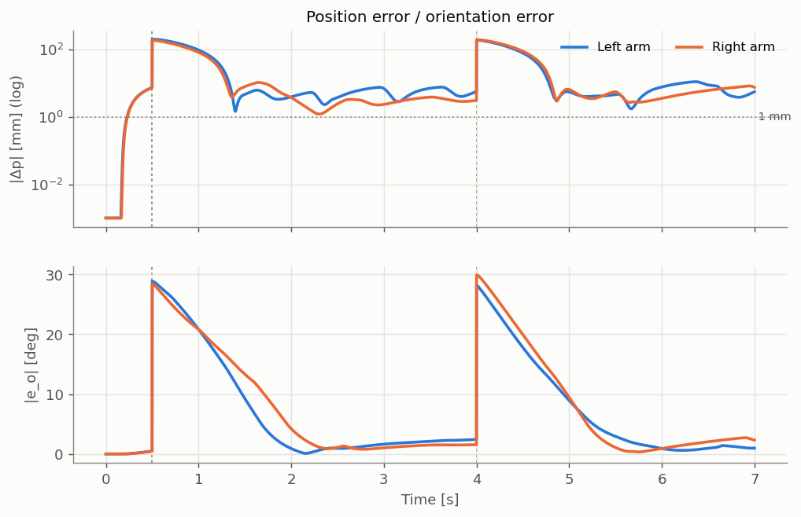
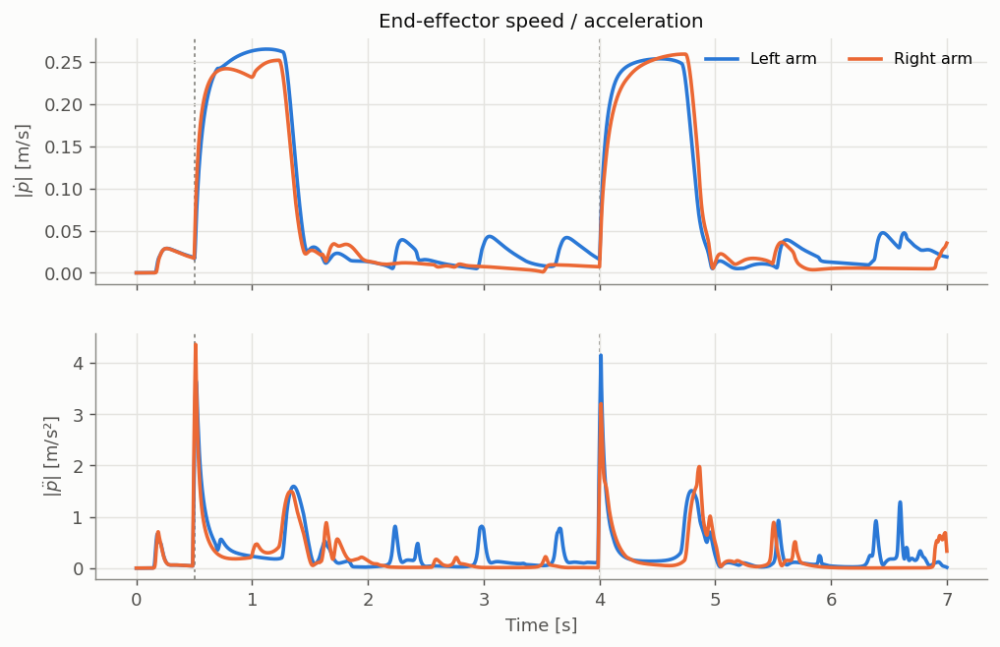
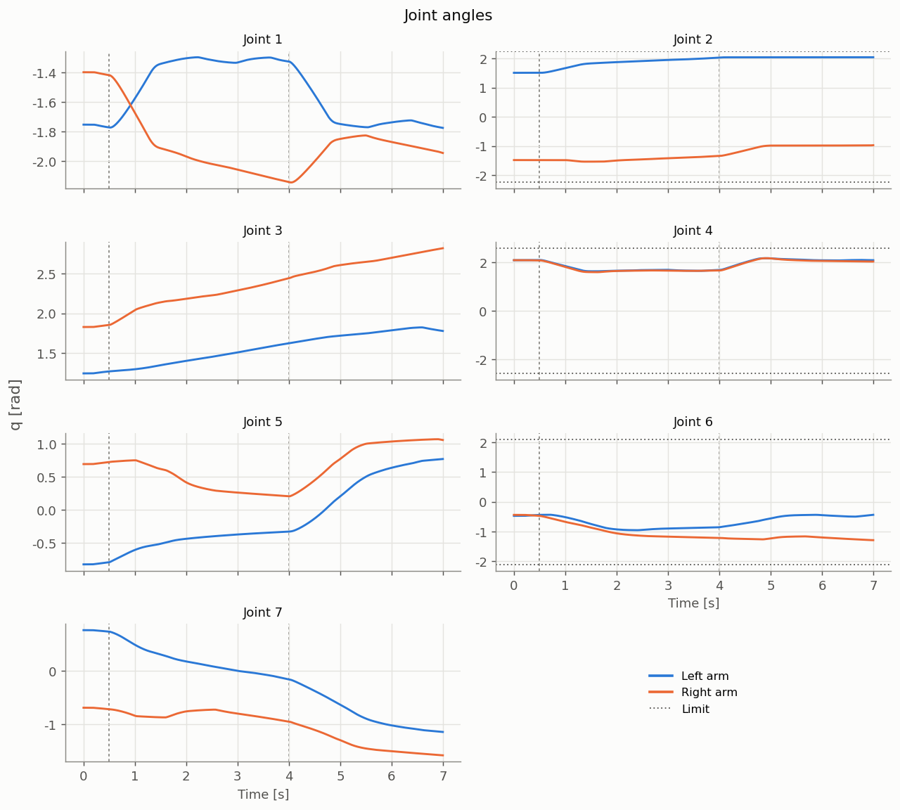
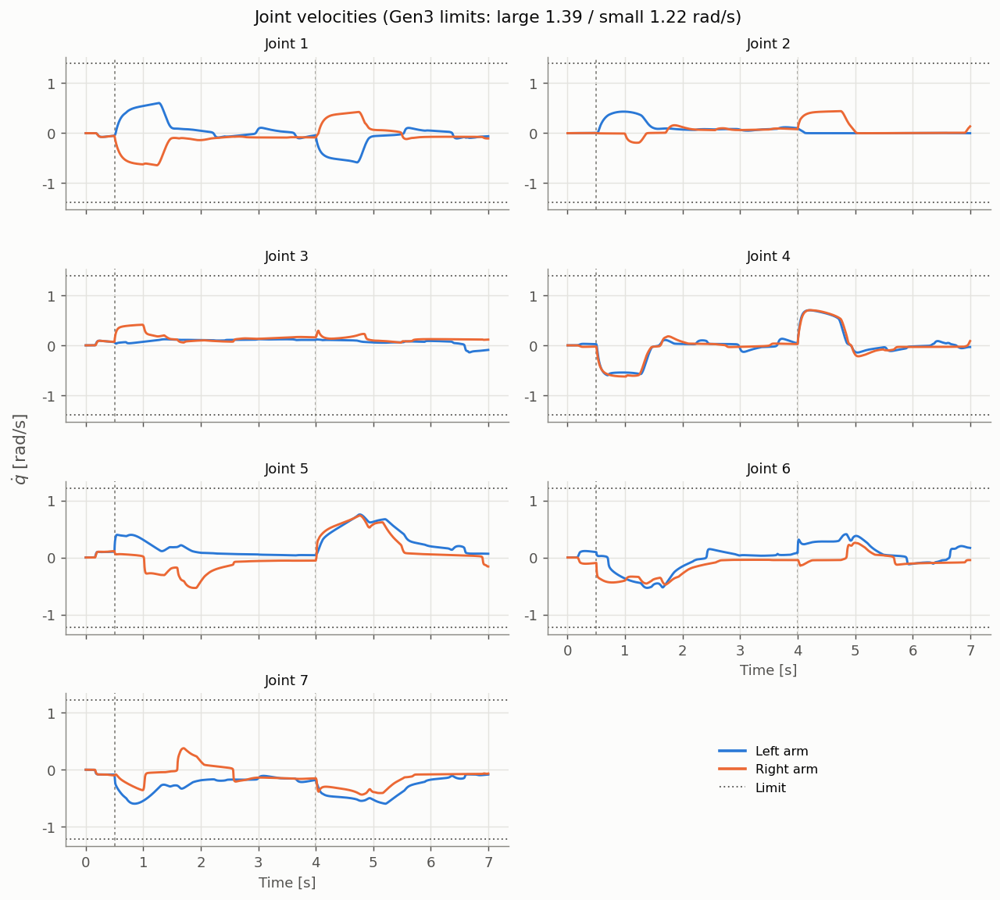
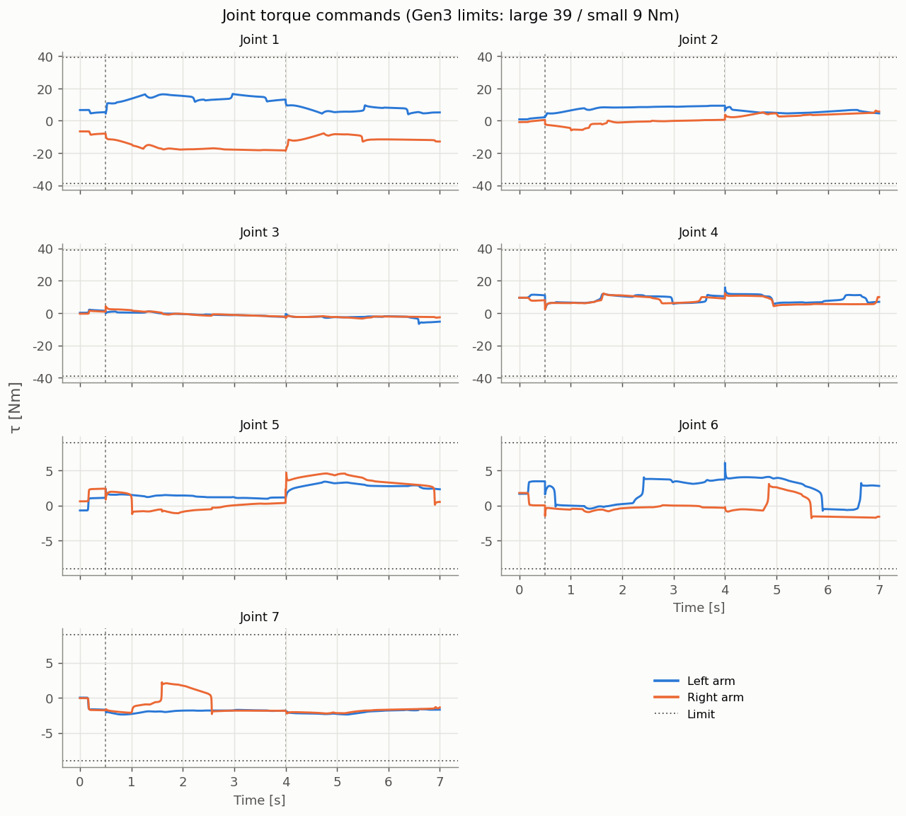
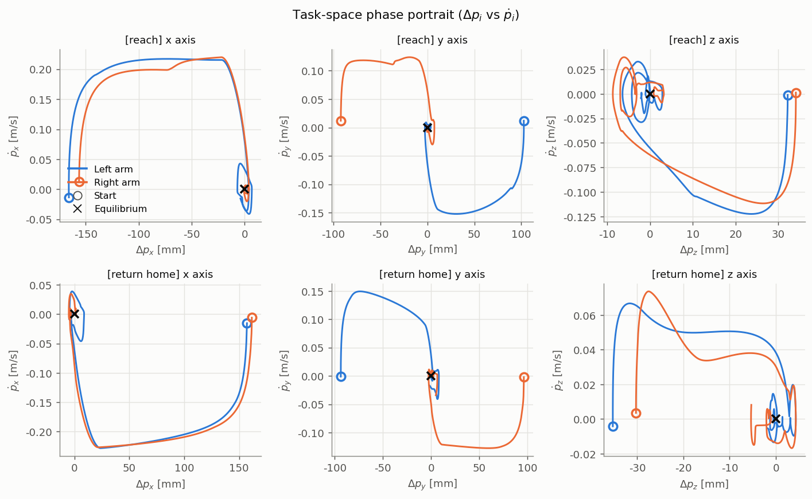
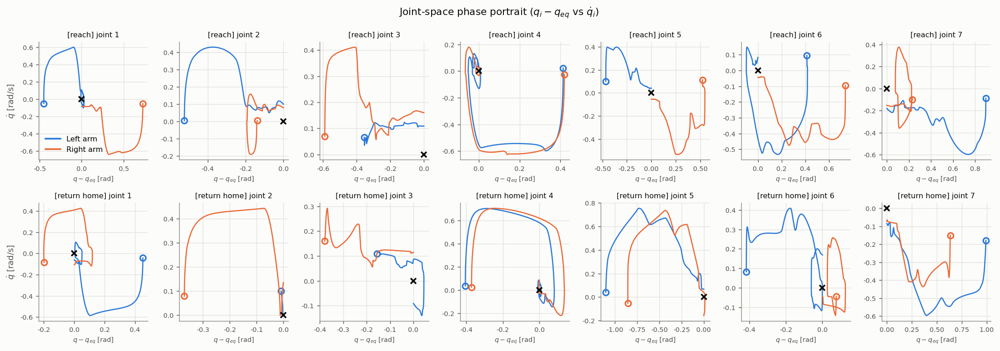
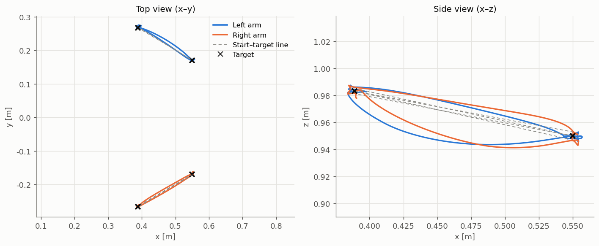

# VSD control analysis — `reach__current_fc`

## Controller
VSD control law (Arimoto & Sekimoto):

```
τ = −C₀q̇ − Jᵀ(k·Δp + ζ√k·ṗ) + Jωᵀ(k_o·e_o − ζ_o√k_o·ω) + g(q) + τ_fric + Jᵀf_rep
C₀ = α·√H₀ ,  H₀ = diag(Σⱼ H_M,ij)
```

| Parameter | Value |
|---|---|
| Task-space spring k | 600.0 N/m (saturation 15.0 N) |
| Task-space damping ζ | 1.5 (c = ζ√k = 36.7 N·s/m) |
| Joint damping α | 1.0 → C₀ = diag(2.07, 2.06, 1.37, 1.54, 0.79, 0.86, 0.22) N·m·s/rad |
| Orientation spring k_o / ζ_o | 30.0 N·m/rad (saturation 3.0 N·m) / 1.0 |
| Repulsion k_rep / r_th | 3.75 N·m / 0.3 m |
| Actuator mode | current (friction compensation on) |

## Actuator model (Kinova Gen3)
| Item | Large (1–4) | Small (5–7) |
|---|---|---|
| Gear ratio | 100:1 | 100:1 |
| Torque limit | 39 Nm | 9 Nm |
| Velocity limit | 1.39 rad/s | 1.22 rad/s |
| Reflected rotor inertia | 0.015 kg·m² | 0.01928 kg·m² |
| Friction (Coulomb / viscous) | 2.15 Nm / 2.0 Nm·s/rad | 1.6 Nm / 1.36 Nm·s/rad |

## Step-response metrics

| Segment | Arm | Step [mm] | Orientation step [deg] | Rise time 10–90% [s] | Settling time 2% [s] | Overshoot [%] | Steady-state error [mm] / [deg] | Peak EE speed [m/s] | Max path deviation [mm] | Path length / straight line | Peak q̇/limit | Peak τ/limit |
|---|---|---|---|---|---|---|---|---|---|---|---|---|
| hold home | Left arm | 0.0 | – | – | – | – | – | – | – | – | – | – |
| hold home | Right arm | 0.0 | – | – | – | – | – | – | – | – | – | – |
| reach | Left arm | 197.7 | 28.9 | 0.63 | – | 2.6 | 4.53 / 2.353 | 0.265 | 22.5 | 1.319 | 0.49 | 0.45 |
| reach | Right arm | 184.6 | 28.4 | 0.62 | 3.07 | 4.2 | 2.90 / 1.520 | 0.252 | 21.2 | 1.231 | 0.46 | 0.47 |
| return home | Left arm | 186.4 | 28.2 | 0.60 | – | 2.3 | 4.33 / 1.048 | 0.253 | 13.1 | 1.261 | 0.62 | 0.68 |
| return home | Right arm | 190.6 | 29.9 | 0.62 | – | 2.9 | 7.84 / 2.602 | 0.259 | 6.8 | 1.154 | 0.60 | 0.52 |

- Minimum distance between end-effectors: 0.332 m (repulsion threshold r_th = 0.3 m)
- Maximum number of contacts: 0

## Figures










